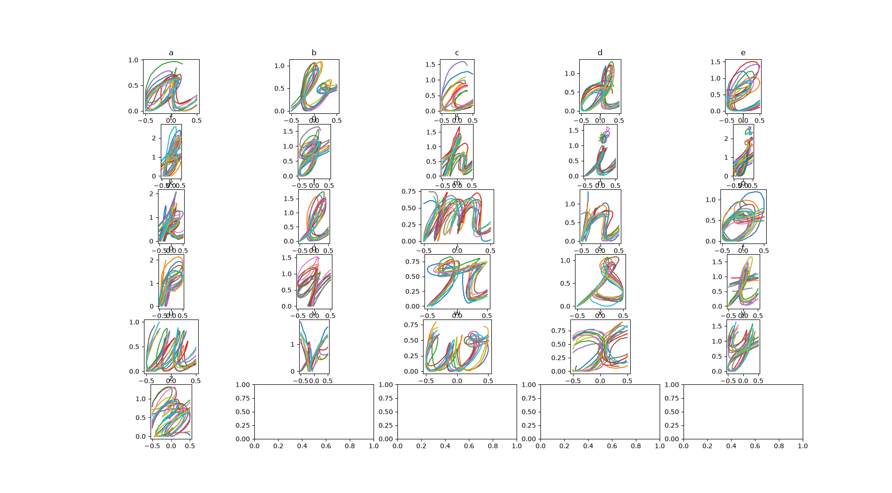

# Handwriting collection

Uses `pointerevent` to collect high-resolution samples of pointer movement produced by a user. Collects all movement over the canvas, even before the first `pointerdown`, so that we can capture user accelerations in the window before first contact.

Allows for quick trajectory reset (`C`) and submitting (`E`) for a quick collection loop. Thousands of single-letter and two-letter samples have been collected using this workflow for a prototype for an abandoned project idea while I was taking CS 7648: Interactive Robot Learning with Dr. Gombolay.

A sample of the collection workflow

A collection of sample of letters, collected using stylus (Wacom) and touchscreen on an Inspiron laptop

